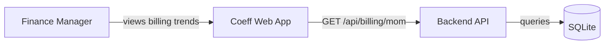
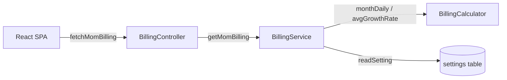

# CHNG-009: Design — Javalin parity phase 2 MoM billing

## Decisions

- **One `getMomBilling` overload**: The Javalin reference has `getMomBilling(int year)` and a no-arg `getMomBilling()`. Both return `MomBillingResponse`. The year-filtered version returns a single year's data; the no-arg returns all years (earliest to current). This is mirrored exactly.
- **`workingDays` = `coef_days_month`**: The Javalin reference stores `coef_days_month` (computed from `working_days` JSON in settings). The coefficiency project stores it as `fiscal.coefDaysMonth` directly. The `MomBillingRow.workingDays` field will read this setting. The per-month `dailyBilling * cm` formula matches existing usage in `BillingService.summary()`.
- **Projection uses `trailingAvg` + `avgGrowthRate`**: Same logic as Javalin's BillingService. The lookback window is 3 months. Growth rate is capped at ±50% to prevent unrealistically explosive projections.
- **MoM chart overlays previous year**: The frontend fetches MoM data for both `currentYear` and `currentYear - 1`. The combined data drives a dual-axis `LineChart` (monthly billing on left Y, MoM growth % on right Y).
- **Year selector for MoM table**: The table below the chart uses a `<select>` populated from available years in the monthly breakdown data, matching the pattern used in the Javalin frontend.

## Data Model

```java
// MomBillingRow — per-month record
public record MomBillingRow(
    String month,
    double dailyBilling,
    int workingDays,
    double monthlyBilling,
    Double billingDelta,    // null for first month
    Double momGrowthPct,    // null for first month
    boolean projected
) {
    public MomBillingRow {
        if (workingDays < 0) throw new IllegalArgumentException("workingDays must be non-negative");
    }
}

// MomBillingResponse — response envelope
public record MomBillingResponse(int year, List<MomBillingRow> rows) {}
```

## Interfaces

### Backend — `GET /api/billing/mom`

| Param | Type | Required | Description |
|-------|------|----------|-------------|
| year | Integer | No | Year to filter (defaults to all years) |

Response: `MomBillingResponse` with year and rows array.

Implementation pattern — the coefficiency project uses Jooby (@GET/@Path) rather than Javalin's handler-based routing, so the MoM endpoint will be added to `BillingController` as a third endpoint alongside `/summary` and `/monthly`.

### Frontend — API and types

Add to `types.ts`:
```typescript
export interface MomBillingRow {
  month: string;
  dailyBilling: number;
  workingDays: number;
  monthlyBilling: number;
  billingDelta: number | null;
  momGrowthPct: number | null;
  projected: boolean;
}

export interface MomBillingResponse {
  year: number;
  rows: MomBillingRow[];
}
```

Add to `api.ts`:
```typescript
export async function fetchMomBilling(year?: number): Promise<MomBillingResponse> {
  const query = year ? `?year=${year}` : '';
  return request<MomBillingResponse>(`/billing/mom${query}`);
}
```

## C4 Model

### Context (Level 1)



```
[Finance Manager] ──→ [Coeff Web App] ──HTTP──→ [Backend API] ──→ [(SQLite)]
```

### Container (Level 2)



```
[React SPA] ──fetch──→ [BillingController] ──→ [BillingService] ──→ [BillingCalculator]
                                                              ──→ [(SQLite settings)]
```

### Component (Level 3)

```mermaid
flowchart LR
  subgraph BillingController
    getMom[GET /mom]
  end
  subgraph BillingService
    getMomYear[getMomBilling(year)]
    getMomAll[getMomBilling()]
    buildActual[buildActualMomRow]
  end
  subgraph BillingCalculator
    monthDaily[monthDaily]
    trailingAvg[trailingAvg]
    avgGrowthRate[avgGrowthRate]
    projectedRemaining[projectedRemaining]
  end
  getMom --> getMomYear
  getMom --> getMomAll
  getMomYear --> buildActual
  getMomAll --> buildActual
  buildActual --> monthDaily
  getMomYear --> trailingAvg
  getMomYear --> avgGrowthRate
  getMomYear --> projectedRemaining
```

```
[BillingController]
  └── GET /api/billing/mom
       ├── getMomBilling(year)  → buildActualMomRow → monthDaily()
       │                          trailingAvg(), avgGrowthRate(), projectedRemaining()
       └── getMomBilling()      → buildActualMomRow → monthDaily()
```

## Files

### New files

| File | Description |
|------|-------------|
| `services/coeff/src/main/java/io/bitnomio/coeff/billing/domain/MomBillingRow.java` | MoM row record with validation |
| `services/coeff/src/main/java/io/bitnomio/coeff/billing/domain/MomBillingResponse.java` | MoM response envelope |

### Modified files

| File | Change |
|------|--------|
| `services/coeff/.../billing/BillingController.java` | Add `GET /mom` endpoint |
| `services/coeff/.../billing/BillingService.java` | Add `getMomBilling(int year)`, `getMomBilling()`, `buildActualMomRow()`, `readCoefDaysMonth()` |
| `services/coeff/.../billing/domain/BillingCalculator.java` | No changes needed — `monthDaily`, `trailingAvg`, `avgGrowthRate`, `projectedRemaining` already exist |
| `services/coeff/frontend/src/types.ts` | Add `MomBillingRow` and `MomBillingResponse` interfaces |
| `services/coeff/frontend/src/api.ts` | Add `fetchMomBilling()` function |
| `services/coeff/frontend/src/pages/BillingSummaryPage.tsx` | Add MoM chart, MoM table with year selector, MoM summary cards |
