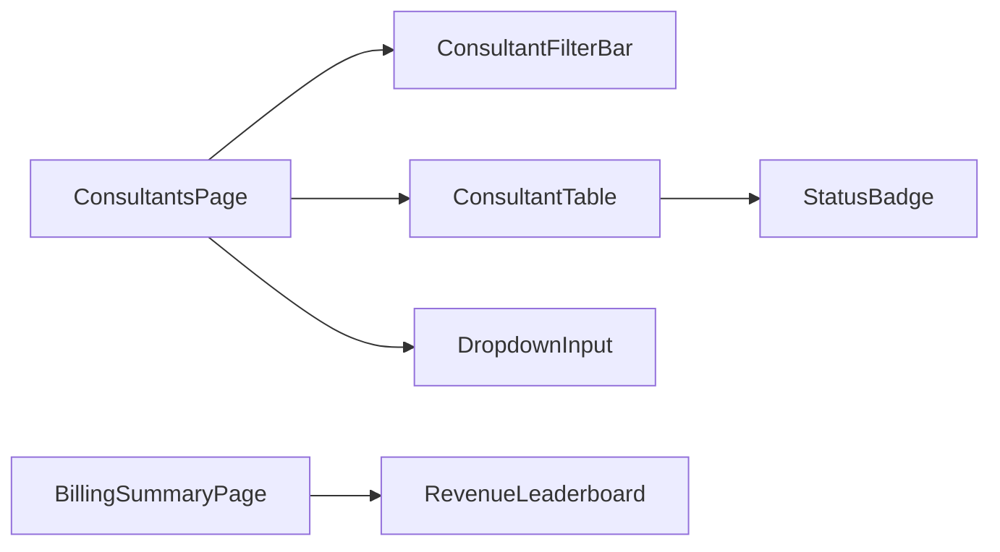

# CHNG-011: Design — Javalin parity phase 4 frontend extraction

## Decisions

- **Function components, not classes** — all extracted components use function syntax with hooks, matching existing codebase style.
- **Props interface exported** — each component exports its Props interface for type safety and reuse.
- **Inline DropdownInput → extracted** — the 67-line inline DropdownInput in ConsultantsPage is identical in behavior to the Javalin reference; extract as-is with coefficiency's code style (no `@/components/ui/label` import style change).
- **ConsultantTable mirrors coefficiency columns** — does NOT add Javalin's `status` or `profitabilityStatus` columns (those require backend type changes). Keeps coefficiency's current column set: name, client, position, startDate, endDate, daysInRole, coefPercentage, tariff, managerBonus.
- **StatusBadge created but not wired** — the Javalin StatusBadge depends on `profitabilityStatus` not yet on coefficiency's Consultant type. Component is created for future use when the backend adds the field.
- **ConsultantFilterBar simplified** — coefficiency only has a search input (no status tabs or coef filter pills). The extracted component wraps just the search input, keeping room for future filter expansion.
- **RevenueLeaderboard standalone** — self-contained component with sorting, search, pagination. Receives `ConsultantBrief[]` as prop (locally defined in BillingSummaryPage for now; extraction to shared types.ts is deferred).

## Data Model

No new data model changes. Uses existing types:
- `Consultant` from `@/types` (for ConsultantTable, DropdownInput)
- `ConsultantBrief` locally defined in BillingSummaryPage (id, name, client, tariff, coefPercentage, position, coefMargin, managerBonus, fees)

## Interfaces

### New component interfaces

```typescript
// DropdownInput — same as current inline
interface DropdownInputProps {
  id: string;
  label: string;
  value: string;
  options: string[];
  onChange: (v: string) => void;
}

// ConsultantTable — coefficiency column set (no status/profitability)
type SortField = 'name' | 'client' | 'position' | 'startDate' | 'endDate'
               | 'daysInRole' | 'coefPercentage' | 'tariff' | 'managerBonus' | 'id';

interface ConsultantTableProps {
  consultants: Consultant[];
  sortField: SortField;
  sortDir: 'asc' | 'desc';
  onSort: (field: SortField) => void;
  coefAlertThreshold: number;
  onShow: (c: Consultant) => void;
  onEdit: (c: Consultant) => void;
  onDelete: (c: Consultant) => void;
  fmt: (n: number) => string;
  emptyI18n?: string;
}

// ConsultantFilterBar — simplified (search only)
interface ConsultantFilterBarProps {
  searchQuery: string;
  onSearchChange: (q: string) => void;
  onPageReset: () => void;
}

// StatusBadge — matches Javalin reference
interface StatusBadgeProps {
  status?: string;
}

// RevenueLeaderboard — matches Javalin reference
type SortField = 'fees' | 'tariff' | 'coefMargin' | 'coef' | 'name' | 'client' | 'position';

interface RevenueLeaderboardProps {
  consultants: ConsultantBrief[];
  onRowClick?: (consultant: ConsultantBrief) => void;
}
```

## C4 Model

No architectural changes — this is a refactoring within the same React frontend container. Component hierarchy changes:

### Component (Level 3)



```
ConsultantsPage ──→ ConsultantFilterBar
ConsultantsPage ──→ ConsultantTable
ConsultantsPage ──→ DropdownInput
ConsultantTable ──→ StatusBadge
BillingSummaryPage ──→ RevenueLeaderboard
```

## Files

### New files

| File | Purpose |
|------|---------|
| `components/consultants/DropdownInput.tsx` | Extracted from ConsultantsPage lines 56–122 |
| `components/consultants/ConsultantTable.tsx` | Extracted from ConsultantsPage lines 524–594 |
| `components/consultants/ConsultantFilterBar.tsx` | Extracted from ConsultantsPage lines 511–522 |
| `components/consultants/StatusBadge.tsx` | New component from Javalin reference (profitability status badge) |
| `components/RevenueLeaderboard.tsx` | New component from Javalin reference (sortable/paginated leaderboard) |

### Modified files

| File | Change |
|------|--------|
| `pages/ConsultantsPage.tsx` | Remove inline DropdownInput, inline table, inline search; import components; remove unused imports |
| `pages/BillingSummaryPage.tsx` | Replace inline leaderboard table with RevenueLeaderboard component |
