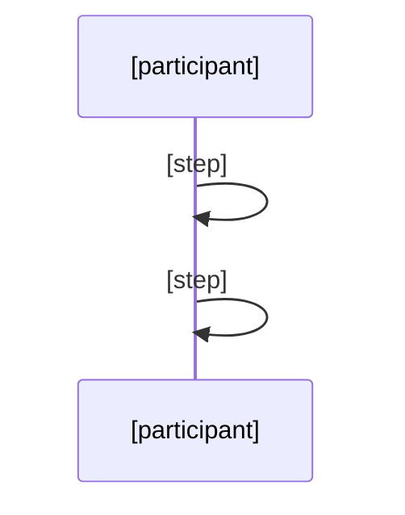

# Deep Architecture Audit Workflow

> Shared workflow for `/backbone:map --deep-arch`. Referenced by both Claude Code and OpenCode command files.

## Process

### Step 1: Load required skills
Load `cross-cutting/architecture` via skill tool.

### Step 2: Run structural reverse-engineering with --apply
```bash
bash ~/.backbone/scripts/reverse-engineer.sh --project-dir <path> --apply
```

### Step 3: Determine CHNG folder path
```bash
CHNG_DIR=$(ls -d backbone/artifacts/changes/CHNG-* 2>/dev/null | sort -r | head -1)
```
All deep-arch output goes into `$CHNG_DIR`.

### Step 4: Spawn 3 parallel explorers

Spawn these 3 subagents simultaneously via Task tool. Each agent writes findings directly and returns a brief confirmation only (not findings content).

**Explorer 1 — Structure & Dependencies:**
```
subagent_type: implementer
prompt: |
  FILES: [$CHNG_DIR/structure-findings.md]

  Analyze the project source code for module structure.
  For each subdomain/module:
  1. Count files in domain/, app/, api/ports/, infra/, config/
  2. Calculate percentages; flag subdomains with 0% domain
  3. Check layer violations: framework annotations in app/, infra leaks into domain/
  4. Circular dependencies between subdomains
  5. DDD compliance: anemic models, value objects, domain events
  6. SOLID violations: god classes (>300 lines), fat interfaces (>5 methods)
  7. Port/adapter naming audit: count *Port, *Store, *ReadPort, *WritePort, *View, *Row per subdomain
  8. jMolecules annotation coverage: grep @Domain, @Application, @Infrastructure, @Port, @Adapter
  9. Test gap heatmap: subdomain | src files | test files | coverage%
  10. Coupling fan-in/fan-out between subdomains
  Write findings to $CHNG_DIR/structure-findings.md
```

**Explorer 2 — Data Flow & Health:**
```
subagent_type: implementer
prompt: |
  FILES: [$CHNG_DIR/health-findings.md]

  Analyze the project for:
  1. Data flow: entry points (controllers, listeners, schedulers), trace 2-3 key paths with Mermaid sequenceDiagrams
  2. Code health: score 0-10 for readability, maintainability, testability, complexity, documentation
  3. Duplicate code across subdomains
  4. Security surface: authenticated vs public endpoints
  5. Performance anti-patterns: N+1 queries, missing caching, sync-in-async, @Transactional misuse
  6. Coupling scores 0-10 per subdomain; blast radius leader
  7. Blast radius: top 3 most-imported modules + affected files (ASCII tree)
  8. Configuration smells: hardcoded URLs, credentials, localhost, env-specific values
  Write findings to $CHNG_DIR/health-findings.md
```

**Explorer 3 — Config & Integration:**
```
subagent_type: implementer
prompt: |
  FILES: [$CHNG_DIR/integration-findings.md]

  Analyze the project for:
  1. External integrations: API URLs, exchange endpoints, WebSocket URLs
  2. C4 System Context Mermaid diagram (project + external systems + users)
  3. Dependency analysis: major libraries with versions, flag outdated
  4. Configuration surface: all configurable properties by category
  5. API surface: all @RequestMapping/@GetMapping/@PostMapping paths grouped by subdomain
  6. External dependency graph: which subdomains connect to which external system via what protocol
  Write findings to $CHNG_DIR/integration-findings.md
```

### Step 5: Verify explorers completed
```bash
ls -la "$CHNG_DIR"/structure-findings.md "$CHNG_DIR"/health-findings.md "$CHNG_DIR"/integration-findings.md
```

### Step 6: Synthesize into arch-depth-report.md

Read all 3 findings files. Produce a structured report using the template below. Fill every section — use "Not detected" if nothing found for a section.

### Step 7: Secret scan before writing report

```bash
grep -nE '(sk-[a-zA-Z0-9]{20,}|sk_live_|sk_test_|ghp_[a-zA-Z0-9]{36}|gho_[a-zA-Z0-9]{36}|AKIA[A-Z0-9]{16}|xox[baprs]-[a-zA-Z0-9-]+|-----BEGIN.*PRIVATE KEY|eyJ[a-zA-Z0-9_-]+\.eyJ[a-zA-Z0-9_-]+\.)' "$CHNG_DIR"/*.md 2>/dev/null && echo "⚠️  SECRETS DETECTED — review before proceeding" || echo "✓ No secrets found in findings"
```

If secrets found, prompt user to review and redact before continuing.

### Step 8: Write arch-depth-report.md

Write to `$CHNG_DIR/arch-depth-report.md` using the template below. Merge explorer findings into each section.

### Step 9: Update metadata files with findings

For each critical finding (severity ≥ high):
- Append Decision entry to `backbone/5-DECISIONS.md` with context/decision/why
- Append Lesson entry to `backbone/6-MEMORY.md` with evidence + recommended action

For medium/low findings:
- Append Lesson entry to `backbone/6-MEMORY.md` only

### Step 10: Cross-reference 6-MEMORY.md

Read `backbone/6-MEMORY.md`. If any previously documented issues are found in current codebase, flag them in the report's Memory Cross-Reference section.

### Step 11: Register QMS NCRs

For findings with severity ≥ major:
```bash
mkdir -p backbone/artifacts/qms/ncr
```
Write NCR-XXX.yml per critical finding.

### Step 12: Secret scan final output

```bash
grep -nE '(sk-[a-zA-Z0-9]{20,}|sk_live_|sk_test_|ghp_[a-zA-Z0-9]{36}|AKIA[A-Z0-9]{16}|-----BEGIN.*PRIVATE KEY)' "$CHNG_DIR/arch-depth-report.md" 2>/dev/null && echo "⚠️  SECRETS IN REPORT — remove before committing" || echo "✓ Report clean"
```

### Step 13: Cleanup
```bash
rm -f "$CHNG_DIR"/structure-findings.md "$CHNG_DIR"/health-findings.md "$CHNG_DIR"/integration-findings.md
```

---

## Report Template

Use this structure for `arch-depth-report.md`. Fill every section with actual findings from the explorers.

```markdown
# Architecture Depth Report — [project name]

**Date:** [date] | **Scope:** Full architecture audit

---

## Executive Summary

Top findings by severity:

| Severity | Finding | Module | Recommendation |
|----------|---------|--------|----------------|
| Critical | [short description] | [module] | [action] |
| High | [short description] | [module] | [action] |
| Medium | [short description] | [module] | [action] |
| Low | [short description] | [module] | [action] |

---

## Module Thickness

For each subdomain, report file distribution across layers. Sources: structure-findings.md.

| Subdomain | Total | domain% | app% | ports% | infra% | config% | Assessment |
|-----------|-------|---------|------|--------|--------|---------|------------|
| [name] | [N] | [N%] | [N%] | [N%] | [N%] | [N%] | healthy/anemic/procedural |
| [name] | [N] | [N%] | [N%] | [N%] | [N%] | [N%] | healthy/anemic/procedural |

**Assessment rules:**
- domain% < 10% → anemic (no business logic)
- app% > 50% → procedural (orchestration-heavy)
- infra% > 40% → framework-coupled
- ports% < 5% → missing abstraction boundary

---

## Test Gap Heatmap

Sources: structure-findings.md (test counts).

| Subdomain | src files | test files | coverage% | Assessment |
|-----------|-----------|------------|-----------|------------|
| [name] | [N] | [N] | [N%] | adequate/gap/critical |

Flag any subdomain with <20% coverage as critical gap.

---

## Layer Boundaries

Sources: structure-findings.md (violations). For each violation found:

**Violation:** [description]
- **Location:** `[file:line]`
- **Issue:** [what rule was broken]
- **Impact:** [what can go wrong]

---

## Port/Adapter Naming Audit

Sources: structure-findings.md (naming patterns).

| Pattern | Subdomains Using It | Count | Consistent? |
|---------|---------------------|-------|-------------|
| *Port | [list] | [N] | yes/no |
| *Store | [list] | [N] | yes/no |
| *Adapter | [list] | [N] | yes/no |
| *Impl | [list] | [N] | yes/no |

**Recommendation:** [single naming convention to standardize on]

---

## jMolecules Annotation Coverage

Sources: structure-findings.md (annotation grep).

| Annotation | Subdomains With | Coverage | 
|------------|-----------------|----------|
| @Domain | [list] | [N of M modules] |
| @Application | [list] | [N of M modules] |
| @Port | [list] | [N of M modules] |
| @Infrastructure | [list] | [N of M modules] |
| @Adapter | [list] | [N of M modules] |

---

## Dependency Flow

Sources: structure-findings.md (coupling). Mermaid flowchart:

```mermaid
flowchart TD
  [subdomain] --> [depends-on]
  [subdomain] --> [depends-on]
```

**Coupling table:**

| Subdomain | fan-in | fan-out | coupling score | Role |
|-----------|--------|---------|----------------|------|
| [name] | [N] | [N] | [0-10] | hub/leaf/isolated |

**Hub modules** (high fan-in) are risk points — changes here cascade widely.
**Isolated modules** (zero fan-in/out) may be dead code or external utilities.

---

## Blast Radius Analysis

Sources: health-findings.md (blast radius).

| Module | Files That Would Break | Blast Radius |
|--------|------------------------|--------------|
| [top module] | [N files] | [which files] |
| [2nd module] | [N files] | [which files] |
| [3rd module] | [N files] | [which files] |

---

## Code Health

Sources: health-findings.md (scores).

| Dimension | Score | Evidence |
|-----------|-------|----------|
| Readability | [0-10] | [specific file examples] |
| Maintainability | [0-10] | [specific file examples] |
| Testability | [0-10] | [specific file examples] |
| Complexity | [0-10] | [specific file examples] |
| Documentation | [0-10] | [specific file examples] |

Score < 4: critical concern. Score 4-6: needs improvement. Score 7+: acceptable.

---

## Data Flow

Sources: health-findings.md (sequence diagrams). Key paths traced:



---

## DDD Compliance

Sources: structure-findings.md (DDD analysis).

| Pattern | Status | Evidence |
|---------|--------|----------|
| Aggregates | ✅/⚠️/❌ | [details] |
| Value Objects | ✅/⚠️/❌ | [details] |
| Domain Events | ✅/⚠️/❌ | [details] |
| Anemic Models | ✅/⚠️/❌ | [details] |

---

## SOLID Analysis

Sources: structure-findings.md (SOLID violations).

| Principle | Risk | Details |
|-----------|------|---------|
| SRP | [low/med/high] | [god classes, mixed concerns] |
| OCP | [low/med/high] | [open for extension?] |
| LSP | [low/med/high] | [substitution violations] |
| ISP | [low/med/high] | [fat interfaces] |
| DIP | [low/med/high] | [abstractions vs concretions] |

---

## Security Surface

Sources: health-findings.md (auth analysis).

| Endpoint | Method | Auth Required | Auth Mechanism |
|----------|--------|---------------|----------------|
| [path] | GET/POST | yes/no | [@PreAuthorize, etc.] |

**Gaps:** [endpoints that appear public but should be authenticated]

---

## Configuration Smells

Sources: health-findings.md (config scan).

| Type | Finding | File | Severity |
|------|---------|------|----------|
| Hardcoded URL | [value] | `[file]` | high/med/low |
| Credential | [key] | `[file]` | critical |
| Env-specific | [value] | `[file]` | low |

---

## Performance Anti-Patterns

Sources: health-findings.md (perf analysis).

| Pattern | Location | Impact | Fix |
|---------|----------|--------|-----|
| N+1 query | `[file:line]` | [what degrades] | [how to fix] |
| Missing cache | `[file:line]` | [what degrades] | [how to fix] |
| Sync-in-async | `[file:line]` | [what degrades] | [how to fix] |

---

## Memory Cross-Reference

Sources: 6-MEMORY.md patterns vs current codebase.

| Known Issue from 6-MEMORY.md | Found in Current Codebase? | Location |
|------------------------------|---------------------------|----------|
| [pattern] | yes/no | [if yes: where] |
| [pattern] | yes/no | [if yes: where] |

---

## Recommendations

Ordered by effort/impact. Top priority first.

| Priority | Recommendation | Effort | Impact | Module |
|----------|---------------|--------|--------|--------|
| 1 | [action] | [days] | [what improves] | [module] |
| 2 | [action] | [days] | [what improves] | [module] |
| 3 | [action] | [days] | [what improves] | [module] |
```

---

## Success Criteria

- [ ] Secrets scanned in findings (Step 7)
- [ ] arch-depth-report.md written with all sections filled
- [ ] 5-DECISIONS.md updated for critical/high findings
- [ ] 6-MEMORY.md updated for all findings
- [ ] QMS NCRs registered for severity ≥ major
- [ ] Memory cross-reference completed
- [ ] Secrets scanned in final report (Step 12)
- [ ] Temporary findings files cleaned up
